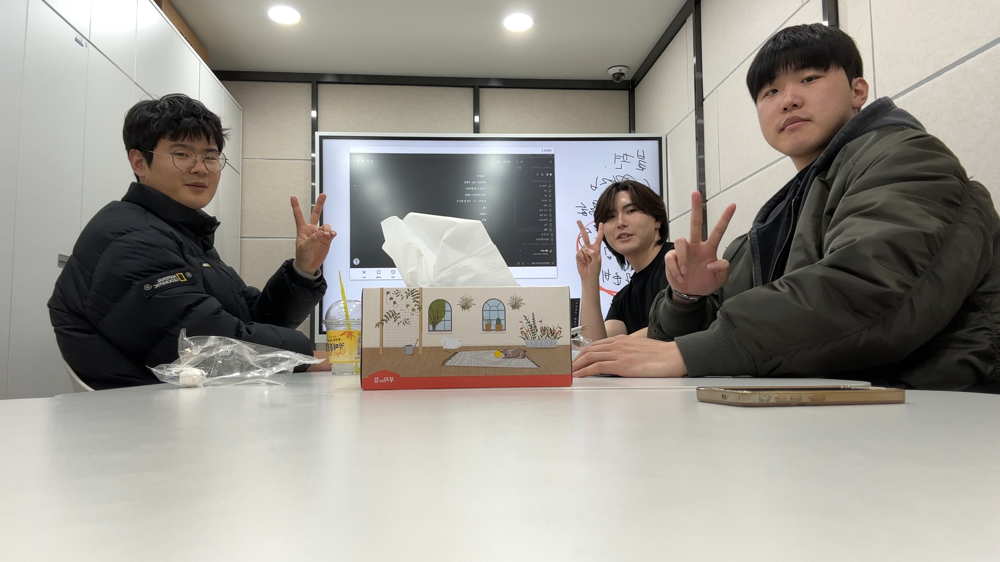

# Meeting Notes

## 1. 회의 정보
- **Date:** 2026-11-22
- **Members:** 이동민, 김상진, 문경욱
- **주제:** 프로젝트 초기 기획 회의

## 2. 회의 목적
- 프로젝트 주제 선정
- 구현 기능 구상 

## 주제 선정
1) 일상 생활의 불편한점
    1. 일본어 학습의 어려움을 느낌 
        (쉐도잉 연습, 작문 연습, 일본어 학습 등의 어려움 해결)
    2. 지금의 검색 서비스에 대한 불편함
        (필요한 정보 외에 불필요한 정보 필터 필요, 정확하고 빠른 검색이 필요)
    3. AI Agent 학습을 위한 프로그램
        (전공 공부에 초점을 둔 프로그램)
    4. 취업 준비의 어려운 점
        (자기분석, 정보 탐색의 어려움 등등)

2) 해결 방안
    1. 쉐도잉 연습 프로그램, 텍스트 파일 분석 -> 단어장 생성 프로그램, 작문 연습 프로그램, 
    2. 필요한 정보만 가져오는 검색 프로그램, GPS이용으로 장소 추천 및 탐색 프로그램, 
    3. 이메일 전송, 인쇄 프로그램, 반복적이고 간단한 일을 대신하는 Agent
    4. 자기분석 도우미, 자기분석 평가 및 피드백, 취업 정보 탐색 및 일자리 추천

3) 최종 주제 선정
    -  자기분석 및 취업 도움 프로그램
        1. 선정 이유
            현재 모두가 일본 취업을 준비하며 느끼는 자기분석의 어려움 해결
            효율적인 정보 탐색 및 취업 준비로 공부에 더 집중 할 수 있는 환경 구축
            현 학우들 뿐만 아니라 앞으로의 후배들에게까지 좋은 환경 제공을 하고 싶어 이 주제로 선정하였다

        2. 이 프로젝트로 인해 기대되는 효과
            - 자기분석의 어려움을 해결, 더 질 좋은 분석을 할 수 있도록 도움
            - 정보 탐색의 시간 절감 -> 자기개발(공부)에 더 많은 시간 사용 가능
            - 자기분석과 맞는 기업정보 제공 -> 자신과 맞는 회사 취업
            - 학우들과 후배들의 사용 -> 사용자 증가로 인한 꾸준한 업데이트 가능성 기대
## 핵심 기능
1. 자기 분석
    - 자기분석의 질문 제공
    - 목표의 회사 설정
    - 자기 분석 피드백 
        1. AI의 피드백 제공
        2. 이메일, 슬랙 등의 전송 기능 추가로 교수님과의 상담 및 피드백 가능

2. 회사 정보 탐색
    - 자신과 맞는 회사 추천
    - 조건에 맞는 회사 검색 기능
    - 회사 리뷰 시스템

3. 미래 설계 시스템
    - 취업 설계 
    - 미래 설계

## 	다음 회의 안건
1. 핵심 기능 구체화
2. 기능 구현 기술 조사 및 발표
3. 구성원 추가

