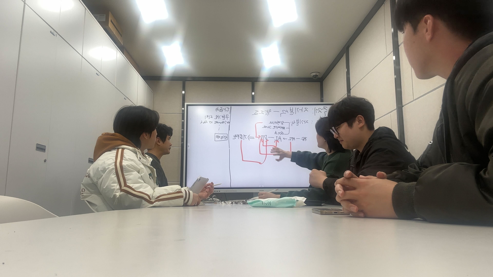

# Meeting Notes

## 회의 정보
- **Date:** 2026-11-27
- **Members:** 이동민, 김상진, 문경욱, 강한빈, 백승록
- **주제:** 기능 구체화

## 회의 목적
-   주제에 맞는 기술 구상 및 구현 기술 구상

## 기능
- 로그인 / 회원가입
    - 결과 저장, 개인정보 보호 등의 이유로 필요

- 자기 분석
    1) 자기 분석 방향성 제시
        - 성격 테스트 검사 (ex. MBTI)
        - 모티베이션 그래프 
        - 자기분석 설문 QnA
    2) 결과 정리 or AI 분석

- 기업 추천
    1) 일본 기업 리스트 제공
        - 탐색 기능 제공 (카테고리)
    2) 자기 분석 내용을 바탕으로 기업 추천

## 사용 될 기능
- Python 3.12
- Fast API , Flask ....
- DB
- HTML, CSS, javascript
- Network
- Open AI 
....
## 	다음 회의 안건
1. 구현 기술 선정
2. 추가 아이디어 회의

